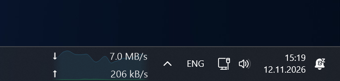

# NetSpeck

**Current download and upload speed inside the standard Windows 11 taskbar.**

[Русский](README.ru.md) · [Download](https://github.com/nt-bro/NetSpeck/releases) · [Report an issue](https://github.com/nt-bro/NetSpeck/issues)

Windows 11 x64 · .NET Framework 4.8 · Portable · MIT



*Actual screenshot with live network traffic.*

## Status and compatibility

**Public preview.** Verified on Windows 11 26H2 **26300.9974**, with the standard taskbar on the primary monitor. Other Windows 11 builds are unverified; Windows 10 is unsupported.

Taskbar integration uses an unofficial native child-window technique. It does not patch Explorer, inject a DLL or require a taskbar replacement. Windows updates can affect compatibility.

Sleep/resume has not been verified. Read [known issues](docs/KNOWN_ISSUES.md) before using the preview.

## Download and run

1. Open [Releases](https://github.com/nt-bro/NetSpeck/releases).
2. Download `NetSpeck-v1.6.1-win-x64.zip` from the release assets. GitHub's automatic **Source code** archives contain source files, not the ready-to-run app.
3. Extract the archive and run `NetSpeck.exe`. No installation or administrator rights are required. The portable EXE is unsigned.
4. Right-click the indicator or its tray icon to open settings. Starting the app again also opens settings.

Close the app before replacing its EXE during an update. If startup is enabled and you move the EXE, disable and re-enable startup to update the path.

## Features

- **Two speed values:** download ↓ and upload ↑, in decimal bytes or bits per second.
- **Independent number averaging:** off or 2 / 3 / 5 / 10 seconds; number refresh every 0.5 / 1 / 2 seconds.
- **Optional background graph:** 15–120 seconds of history, 5–30 fps, graph-only smoothing from 0–5 seconds, colors, opacity, line width, shared auto/fixed scale and optional fill. Both ends fade over 10%.
- **Width by dragging:** enable **Resize panel width**, then drag the left edge. The right edge stays fixed. **Reset panel width** restores automatic sizing.
- **Fonts:** installed families and styles, preview, private TTF/TTC/compatible OTF imports.
- **Icons:** Flows and Speedometer, plus your own ICO/PNG files. Selection changes the tray and app-window icons.
- **Russian and English:** automatic selection from the Windows display language or a saved manual choice; explanatory tooltips for settings and menus.
- **Recovery:** recreates its indicator after Explorer recreates the taskbar. Can start when you sign in.

## What the numbers mean

NetSpeck reads local 64-bit interface byte counters. It does not download a test file or measure your plan's maximum speed. Values include any LAN traffic on the chosen adapter.

Automatic mode selects one adapter using the system internet route. VPN and physical-interface traffic are not added together. With split tunneling, select an adapter manually if needed. Route lookup sends no packets.

Only the primary horizontal taskbar is supported. The app uses available space; it does not reserve an official taskbar slot. If no safe free space can be found, the indicator hides temporarily and reports why in the tray/settings.

## Preferences and privacy

Settings and a bounded local log are stored in `%LOCALAPPDATA%\NetSpeck`. Imported fonts and icons are copied into its `Fonts` and `Icons` folders. Imported assets are private to this app; system fonts are not bundled.

Upgrading from the development version: close the previous app before starting NetSpeck. Existing preferences and imported assets are copied automatically on first launch without removing the originals. Enabled startup is updated to the new EXE.

There is no telemetry, analytics or automatic upload. Diagnostic exports may include adapter names and a taskbar screenshot; review them before sharing.

## Build and test

Requires Windows x64 and its .NET Framework 4.8 compiler. No NuGet packages or .NET SDK are required.

```powershell
powershell -NoProfile -File .\build.ps1
```

This creates `NetSpeck.exe` and runs **66 offline checks**. Close any running copy before rebuilding. To create a portable ZIP and SHA-256 checksum:

```powershell
powershell -NoProfile -File .\scripts\package.ps1
```

Interactive checks require a compatible Windows 11 desktop and an active adapter:

```powershell
powershell -NoProfile -File .\build.ps1 -Integration -Menus
```

These additionally check all four settings tabs in both languages, **80 render cases**, menu/settings behavior and icon imports. They temporarily alter and restore local app preferences. They do not trigger sleep or restart Explorer. CI runs only the build and offline checks; a successful CI build is not a compatibility test for its Windows Server runner.

See [contributing](CONTRIBUTING.md), [release notes](CHANGELOG.md) and [known issues](docs/KNOWN_ISSUES.md).

## License

[MIT](LICENSE). Copyright © 2026 nt-bro.
