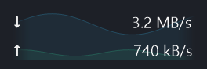
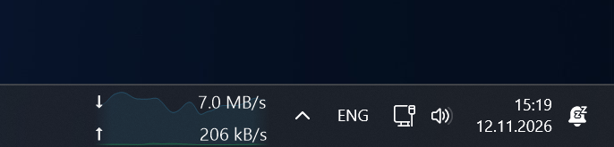
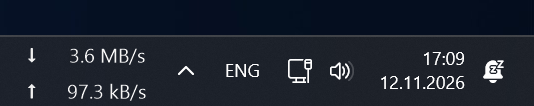

<div align="center">
  <h1>NetSpeck</h1>
  <p><strong>Скорость загрузки и отдачи — прямо в панели задач Windows 11.</strong></p>
  <p></p>
  <p><sub>Пример отрисован приложением · демонстрационные значения</sub></p>
  <p>
    <a href="https://github.com/nt-bro/NetSpeck/releases/tag/v1.6.1"></a>
    
    <a href="https://github.com/nt-bro/NetSpeck/actions/workflows/build.yml"></a>
    <a href="LICENSE"></a>
  </p>
  <p>
    <a href="https://github.com/nt-bro/NetSpeck/releases/download/v1.6.1/NetSpeck-v1.6.1-win-x64.zip"><strong>⬇️ Скачать ZIP</strong></a>
    &nbsp; · &nbsp; <a href="README.md">🇬🇧 English</a>
    &nbsp; · &nbsp; <a href="https://github.com/nt-bro/NetSpeck/issues/new/choose">🐞 Сообщить об ошибке</a>
  </p>
  <p><sub>Без установки · Без прав администратора · Русский и английский · .NET Framework 4.8</sub></p>
</div>

---

## 🚀 Скачать и запустить

1. Откройте [Releases](https://github.com/nt-bro/NetSpeck/releases).
2. Скачайте `NetSpeck-v1.6.1-win-x64.zip` из списка файлов выпуска. Автоматические архивы **Source code** содержат исходники, а не готовую программу.
3. Распакуйте архив и запустите `NetSpeck.exe`. Установка и права администратора не нужны. EXE не имеет цифровой подписи.
4. Нажмите ПКМ по индикатору или его значку в трее. Повторный запуск программы тоже открывает настройки.

Перед заменой EXE при обновлении завершите программу. Если включён автозапуск и вы перенесли EXE, выключите и снова включите автозапуск для обновления пути.

## ✨ Настройте под себя

| Возможность | Что можно настроить |
| :--- | :--- |
| ⬇️ **Загрузка и отдача** | Два значения скорости в десятичных байтах или битах в секунду. |
| 🎚️ **Плавные числа** | Отдельное усреднение: выключено либо 2 / 3 / 5 / 10 секунд. Обновление раз в 0,5 / 1 / 2 секунды. |
| 📈 **График по желанию** | История 15–120 секунд, 5–30 кадров/с, отдельное сглаживание 0–5 секунд, цвета, прозрачность, толщина, шкала и заливка. Затухание по 10% смягчает края. |
| ↔️ **Ширина панельки** | Включите «Изменять ширину» и тяните левый край. Правый остаётся на месте; «Сбросить ширину» возвращает автоматический размер. |
| 🔤 **Шрифты** | Семейство, начертание, предпросмотр и импорт TTF/TTC/совместимых OTF только для приложения. |
| 🎨 **Иконки** | «Потоки», «Спидометр» или свои ICO/PNG для трея и окон программы. |
| 🌐 **Язык** | Русский и английский: автоматически по Windows или вручную. Подсказки объясняют настройки. |
| 🔄 **Автозапуск и восстановление** | Запуск при входе в Windows и пересоздание индикатора после пересоздания панели задач Explorer. |

> [!TIP]
> **Фоновый график можно полностью отключить.** Нажмите ПКМ по индикатору и снимите флажок **«Фоновый график»** либо отключите его в **«Настройки → График»**. Числа загрузки и отдачи продолжат отображаться.

## 🖼️ В панели задач

Реальные снимки работы приложения в Windows 11.

### С фоновым графиком

<p align="center">
  
</p>

### Только числа

<p align="center">
  
</p>

## 🪟 Совместимость

> [!NOTE]
> **Предварительный выпуск:** проверен на Windows 11 26H2 **26300.9974 x64**, со стандартной горизонтальной панелью задач основного монитора. Другие сборки Windows 11 не проверены; Windows 10 не поддерживается.

Встраивание через нативное дочернее окно не является официальным расширением Microsoft. Программа не изменяет код Explorer, не внедряет DLL и не требует замены панели задач. Обновления Windows могут повлиять на совместимость.

Восстановление после сна пока не проверено. Проверенные сценарии и оставшиеся ограничения перечислены в [известных ограничениях](docs/KNOWN_ISSUES.md).

## 🔎 Что измеряется

Программа читает локальные 64-битные счётчики байтов выбранного интерфейса. Ничего не скачивает для теста скорости. Это текущий трафик, включая локальную сеть, а не максимальная скорость тарифа.

Автоматически выбирается один адаптер по системному маршруту в интернет. Физический интерфейс и VPN не складываются. При split tunneling при необходимости выберите адаптер вручную. Поиск маршрута не отправляет пакеты.

Поддерживается основная горизонтальная панель задач. Программа занимает свободное место и не резервирует системный слот. Если безопасного свободного участка нет, индикатор временно скрывается, а причина видна в трее и настройках.

## 🔒 Настройки и приватность

Настройки и ограниченный локальный журнал — в `%LOCALAPPDATA%\NetSpeck`. Свои шрифты и иконки копируются в подпапки `Fonts` и `Icons`; они не устанавливаются для всей Windows. Системные шрифты не входят в поставку.

При переходе с версии для разработки закройте старое приложение перед запуском NetSpeck. Настройки, свои шрифты и иконки скопируются автоматически при первом запуске, исходные файлы сохранятся. Если автозапуск был включён, он будет перенаправлен на новый EXE.

Телеметрии, аналитики и автоматической отправки данных нет. Экспорт диагностики может содержать имена адаптеров и снимок панели задач — просмотрите его перед отправкой.

## 🛠️ Сборка из исходников

Нужны Windows x64 и компилятор .NET Framework 4.8, поставляемый с Windows. NuGet и .NET SDK не требуются.

```powershell
powershell -NoProfile -File .\build.ps1
```

Собирается `NetSpeck.exe` и выполняются **66 автономных проверок**. Перед пересборкой завершите запущенный экземпляр. Создание готового архива и контрольной суммы:

```powershell
powershell -NoProfile -File .\scripts\package.ps1
```

<details>
<summary>🧪 Проверки интерфейса</summary>

Дополнительные проверки требуют совместимого рабочего стола Windows 11 и активного сетевого адаптера:

```powershell
powershell -NoProfile -File .\build.ps1 -Integration -Menus
```

Проверяются четыре вкладки на обоих языках, 80 вариантов отрисовки, меню и импорт значков. Локальные настройки временно меняются и восстанавливаются. Сон и перезапуск Explorer не запускаются. CI выполняет только сборку и автономные проверки; это не проверка совместимости с серверной ОС runner.

</details>

## 🤝 Участие в проекте

Сообщения об ошибках и небольшие, понятные pull request приветствуются. Начните с [руководства по участию](CONTRIBUTING.md), [истории изменений](CHANGELOG.md) и [известных ограничений](docs/KNOWN_ISSUES.md).

## 📄 Лицензия

[MIT](LICENSE). © 2026 nt-bro.
