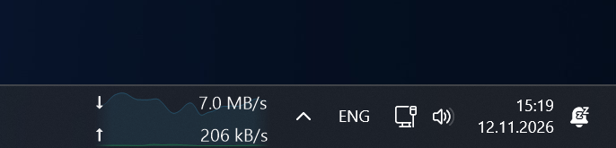
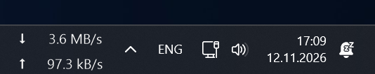

# NetSpeck 1.6.1 — Windows 11 public preview

Current download/upload speed inside the standard Windows 11 taskbar, with Russian and English UI.

## Download

Download **NetSpeck-v1.6.1-win-x64.zip**, extract it and run **NetSpeck.exe**. No installation or administrator rights are required. **Source code** archives are for building the app yourself. A SHA-256 checksum is attached as a separate file.

Features include independent number averaging and graph smoothing, an optional configurable background graph, left-edge width resizing, font and icon imports, optional startup, and explanatory tooltips. Two built-in icons are provided: Flows and Speedometer.

**The graph can be fully disabled** from the indicator's right-click menu or Settings → Graph; download/upload numbers remain visible.

*Actual screenshot with the background graph disabled.*

## Preview compatibility

Verified only on **Windows 11 26H2 26300.9974 x64** with the standard primary horizontal taskbar. Other builds are unverified; Windows 10 is unsupported. Integration is unofficial and Windows updates may affect it. The EXE is unsigned.

Sleep/resume remains unverified. Read [known issues](https://github.com/nt-bro/NetSpeck/blob/main/docs/KNOWN_ISSUES.md).

The build passed 66 offline checks. Interactive development checks passed 112 behavior checks and 80 render cases. These results do not replace testing on your Windows build.

## По-русски

Скачайте **NetSpeck-v1.6.1-win-x64.zip**, распакуйте и запустите **NetSpeck.exe**. Установка и права администратора не нужны. **Фоновый график можно полностью отключить через ПКМ по индикатору или «Настройки → График»**, оставив только числа скорости. Это **предварительный выпуск**: проверена только Windows 11 26H2 26300.9974 x64. Поддержка других сборок не подтверждена, Windows 10 не поддерживается. Восстановление после сна пока не проверено. Подробнее — в README и известных ограничениях.

MIT License. Copyright © 2026 nt-bro.
